# Phase 114: Paja and playground approval flows - Research

**Researched:** 2026-10-17
**Domain:** Host-side permission admission, browser isolation, CSP, and approval management
**Confidence:** HIGH for current-code seams and pinned protocol evidence; MEDIUM for the bounded host-network policy that intentionally does not claim NAP-CONNECT conformance.

<user_constraints>
## User Constraints (from CONTEXT.md)

### Locked Decisions

- Firewall is the shared pure policy authority; runtime owns asynchronous approval coordination, cancellation, enforcement, and lifecycle. Hosts own presentation and actions. Do not create a second host permission store or evaluator.
- Required interface denial prevents execution. Optional denial permits reduced functionality. Bind the injected namespace and later environment delivery to the same approved snapshot, with no undeclared or unapproved domain exposure.
- Use verified manifest identity and artifact bytes for signed apps. Keep unsigned development targets explicit and isolated, with no persistent signed-app grants. Never use names or message identity claims as permission authority.
- Approve before assigning executable bytes to the frame. Revalidate the exact source generation, identity, current grants, and admission result after every asynchronous boundary and immediately before execution.
- Interface permission does not imply resource/network permission or vice versa. ACL and mandatory protocol constraints remain hard limits.
- Show trusted requesting identity, operation, exact target/scope, and offered lifetime. Support allow, deny, and cancellation; expose grants and revocation. Persistent load/save failures must be visible and must not silently allow work.
- Cover ordinary launch, reload, replacement, installed intent targets, shared-link launcher frames, local files, development servers, and simultaneous instances.
- Cancel stale prompts and operations when frames close, navigate, are replaced, or lose relevant grants. A late answer must not authorize a replacement frame.
- Relay/Blossom discovery hints and demo configuration are not direct-network approval. Direct browser grants need explicit exact origins and must be distinct from mediated operation grants. Revocation must retire the executing frame when needed to remove its CSP authority; deleting a stored grant alone is insufficient.
- Keep rate budgets and prompt-spam controls independent. Explain which operations are mediated and metered; do not claim the parent meters direct iframe traffic.
- Migrate signer consent, diagnostics, simulation, configuration, and settings into the shared model without widening existing authority. Retained compatibility needs warnings, central tracking, regression tests, and removal prerequisites.
- Complete docs, package changesets, and real-browser regressions alongside code.

### the agent's Discretion

Choose shared UI and persistence adapter boundaries consistent with framework-free packages and existing app conventions. Choose accessible layout and wording, test fixtures, and plan decomposition. Recheck Phase 113 outputs before fixing concrete API assumptions. Do not change service files concurrently with their executor.

### Deferred Ideas (OUT OF SCOPE)

No host requirement is deferred beyond this milestone. Final cross-consumer audit and shipping remain Phase 115; service execution remains Phase 113. Research may run concurrently, but host implementation must use checked service contracts.
</user_constraints>

<phase_requirements>
## Phase Requirements

| ID | Description | Research Support |
|---|---|---|
| HOST-01 | Paja and playground resolve interface approval before execution; required denial blocks launch and optional denial narrows the injected environment. | Use `RuntimePermissions.admit` plus `isAdmissionCurrent` before `srcdoc`; capture the admitted `domains` as the sole namespace/environment input. |
| HOST-02 | Consistent host approval UI exposes requesting identity, operation, scope, lifetime and revocation. | Add one framework-free host presentation adapter around runtime prompts and one grants/revocation settings surface per host. |
| HOST-03 | All host paths including installed intent targets, local development and reloads enforce the same model. | Route Paja direct, pointer/tab, local-file, shared-intent launcher, reload/replacement, and playground normal/installed-intent loads through the same admission transaction. |
| HOST-04 | Network CSP grants are explicit; infrastructure discovery hints never automatically authorize app network access. | Separate direct CSP connection grants from mediated resource permission; remove Paja hint concatenation and playground static allowlists. |
| HOST-05 | Migrate host callbacks, signer consent, simulation, config and diagnostics without parallel authorization stores. | Preserve host UI callbacks only as prompt presentation, migrate persisted signer decisions and access controls through runtime permissions, and register compatibility warnings/tests. |
</phase_requirements>

## Project Constraints (from AGENTS.md)

- Use the codebase-memory graph first for code discovery; fall back to text search only for literals, configuration, or insufficient graph results.
- Keep TypeScript strict and ESM-only, use 2-space indentation and lowercase-hyphenated filenames; public exports need JSDoc. [VERIFIED: `AGENTS.md`]
- NAP/NIP-5D work must check the relevant authoritative `napplet/naps` document first, record the precise ref, compare messages/lifecycle/trust/CSP rules, and cover both Paja and playground. [VERIFIED: `AGENTS.md`]
- Compatibility retained in this phase must warn on actual legacy use, be centrally tracked in `docs/compatibility.md`, have both legacy/canonical runtime tests, and have stated removal prerequisites. [VERIFIED: `AGENTS.md`]
- Code, tests, docs, and package metadata move together; host/playground changes require `pnpm test:e2e` in addition to build, type, unit, docs, and the configured quality gate before shipping. [VERIFIED: `AGENTS.md`]
- This research task owns only this phase artifact. Existing Phase 113 worktree edits are concurrent work and must not be absorbed, reverted, or relied on as final interfaces. [VERIFIED: orchestrator assignment]

## Summary

Phase 112 already exposes the correct primitive: `RuntimePermissions.admit(windowId, request)` grants only session/persistent interface permissions and `isAdmissionCurrent` invalidates a result when the source, grant revision, or durable store changes. The host must register a provisional trusted session containing a verified principal, await admission, then revalidate immediately before creating the prelude/CSP and assigning `srcdoc`. Current Paja and playground loaders instead derive environments before admission; Paja additionally unions relay/Blossom hints into `connectOrigins`, while playground applies a static resource-demo origin allowlist. [VERIFIED: `packages/runtime/src/{permission-admission,permission-runtime}.ts`, `packages/paja/src/browser-target-frame.ts`, `apps/playground/src/playground-frame-loader.ts`]

The authoritative combination is feasible without dropping network support: a mediated-resource frame has no remote subresource or connection authority, so the resource policy cannot be bypassed; a direct-network/development-server frame receives explicit shared-model network grants for exact origins and does not expose `resource`; and a frame may expose neither. `connect-src 'none'` alone is insufficient for resource isolation if `script-src`, `style-src`, `img-src`, `font-src`, or `worker-src` names a remote origin: those directives still let app-controlled markup send browser requests, including arbitrary paths and queries, to that origin. A usable development flow must therefore choose either a parent-verified, self-contained artifact with all remote subresources denied, or an explicitly approved remote-development network mode; HMR/WebSocket is also direct network authority and requires frame retirement on revocation. [CITED: https://github.com/napplet/naps/blob/ae5b9c64ab8a4d8909f288829a01e99d6bd713bc/naps/NAP-RESOURCE.md] [CITED: https://github.com/dskvr/nips/blob/5560820fa4f37f45b8ab742a11aeb3001b17dc67/5D.md]

**Primary recommendation:** Build a host-neutral admission transaction and presentation/management adapter on top of existing runtime permissions, then make Paja and playground call it on every loader path before binding bytes or CSP; keep CSP construction in `@kehto/shell` as the sole browser-isolation authority.

## Architectural Responsibility Map

| Capability | Primary Tier | Secondary Tier | Rationale |
|---|---|---|---|
| Interface admission and grant lifetime | API / Backend | Browser / Client | Runtime coordinator owns decisions, persistence, cancellation, and revalidation; hosts only ask and display. |
| Trusted principal/session binding | Frontend Server (host runtime) | Browser / Client | The host registers the opaque `Window` with verified signed or explicit development identity before execution. |
| Namespace/CSP construction | Browser / Client | API / Backend | The shell injects a snapshot into `srcdoc`; runtime admission determines the snapshot’s permitted domains. |
| Approval prompt and grant settings | Browser / Client | API / Backend | Paja/playground render identity/scope/lifetime actions; runtime management remains the only state mutation surface. |
| Mediated resource/network enforcement | API / Backend | Browser / Client | Phase 113 authorizes service destinations; frame CSP prevents a browser bypass. |
| Direct origin access and revocation | Browser / Client | API / Backend | Browser CSP enforces exact origins; runtime revocation triggers host frame retirement because the parent cannot intercept traffic. |

## Standard Stack

### Core

| Library / module | Version | Purpose | Why Standard |
|---|---:|---|---|
| `@kehto/runtime` permission runtime | workspace | Admission, grants, persistence, cancellation, revoke | Existing owner of asynchronous approval coordination; do not duplicate it in a host. [VERIFIED: `packages/runtime/src/permission-runtime.ts`] |
| `@kehto/shell` origin registry + `prepareNappletSrcdoc` | workspace | Trusted source binding, immutable environment, CSP/prelude injection | Existing boundary that binds opaque window identity before `srcdoc`. [VERIFIED: `packages/shell/src/{origin-registry,napplet-srcdoc,napplet-csp}.ts`] |
| Browser DOM / `<dialog>` | browser platform | Framework-free prompts and settings | Paja already uses accessible `HTMLDialogElement`; playground uses plain DOM. [VERIFIED: `packages/paja/src/browser-host-signer.ts`, `apps/playground/src/consent-modal.ts`] |
| Vitest + Playwright | `4.1.2` / `1.59.1` installed | Unit and real-browser regressions | Existing project runners; browser assertions are required for CSP and side-effect behavior. [VERIFIED: `package.json`, local version probes] |

### Supporting

| Module | Purpose | When to Use |
|---|---|---|
| `packages/runtime/src/permission-admission.ts` | Converts required/optional interface declarations into scoped admission and issues an opaque admission token. | Every pre-execution host loader. [VERIFIED: source] |
| `packages/shell/src/napplet-csp.ts` | Validates exact HTTP(S)/WS(S) connection origins and rejects broad `connect-src` overrides. | Every signed or development `srcdoc`; any remote source directive belongs to explicit direct-network mode, never a resource-safe bootstrap. [VERIFIED: source] |
| `packages/paja/src/browser-host-signer.ts` | Existing queue/focus/a11y conventions and legacy signer-consent presentation. | Refactor its presentation behavior into the common host approval UI without carrying its store forward. [VERIFIED: source] |

**Installation:** No external package installation is required. [VERIFIED: phase scope and workspace dependencies]

## Architecture Patterns

### System Architecture Diagram

```mermaid
flowchart LR
  A[Pointer / local file / dev target / playground catalog / intent] --> B[Resolve and verify or create explicit dev principal]
  B --> C[Register provisional opaque Window + principal]
  C --> D[RuntimePermissions.admit required and optional interfaces]
  D -->|required denied, cancelled, unavailable| X[Destroy registration/frame; show denied state]
  D -->|admitted| E[Revalidate generation, identity, admission, and grant state]
  E --> F[Build approved domain snapshot]
  F --> G{Frame mode}
  G -->|Mediated resource| H[resource exposed; CSP connect-src none]
  G -->|Direct network| I[resource absent; CSP exact approved connect origins]
  G -->|Development bootstrap| J[exact bootstrap sources; connect-src none unless separately approved]
  H --> K[prepareNappletSrcdoc then assign srcdoc]
  I --> K
  J --> K
  K --> L[Shell validates MessageEvent.source and delivers only snapshot domains]
  M[Grant revoke / source replacement / close] --> N[Cancel pending + destroy session + replace frame]
  N --> A
```



### Pattern 1: Provisional registration → admission → final render

**What:** Allocate the window ID and trusted principal before admission, but do not assign executable bytes or expose a final environment until admission succeeds. Capture generation/registration identity before each `await`; after admission, call `isAdmissionCurrent` and compare the current host generation/identity before `srcdoc`. [VERIFIED: `packages/runtime/src/permission-admission.ts`, `packages/shell/src/origin-registry.ts`]

**When to use:** Paja direct target, pointer-tab, local file, shared-intent launcher, reload/replacement, and playground normal or installed intent load. [VERIFIED: graph traces for `navigateFrame`, `loadRuntimePointer`, `launchPajaSharedIntent`, and `loadPlaygroundNapplet`]

```ts
// Source: packages/runtime/src/permission-runtime.ts and packages/shell/src/napplet-srcdoc.ts
const admission = await bridge.runtime.permissions.admit(windowId, {
  available: hostAvailableDomains,
  required: verifiedManifest.requires,
  optional: verifiedManifest.optional,
});
if (admission.status !== 'admitted' || !isCurrentGeneration()) return destroyProvisional();
if (!bridge.runtime.permissions.isAdmissionCurrent(windowId, admission)) return destroyProvisional();

const environment = environmentFor(admission.domains);
registerExactWindowEnvironment(windowId, principal, environment);
iframe.srcdoc = prepareNappletSrcdoc(verifiedHtml, { domains: admission.domains, csp });
```

### Pattern 2: Three mutually exclusive network/resource modes

| Mode | Namespace | CSP `connect-src` | Permitted | Required behavior |
|---|---|---|---|---|
| Mediated resource | `resource` only if admitted | `'none'`, with no remote source directives | Host/service fetches with Phase 113 scopes and cancellation | Do not expose any remote browser source authority; resource cache/redirect checks remain Phase 113. |
| Direct network / remote development | No `resource` | Exact user-approved HTTP(S)/WS(S) connection origins plus only matching explicitly approved remote source directives | Browser fetch/WebSocket/SSE/EventSource and remote asset loads to those origins | Treat every remote source directive as network authority; display that host cannot inspect/meter calls; revoke by cancelling/retiring the frame. |
| Neither | No `resource` | `'none'` | No arbitrary network path | Default/denied safe state. |

The direct-network and mediated-resource modes cannot coexist in one frame under the checked NAP-RESOURCE prerequisite: direct browser I/O would bypass resource policy. This is a host policy consistent with the goal; do not claim complete NAP-CONNECT conformance because its checked draft assumes a different manifest fold and HTTP response CSP model. [CITED: https://github.com/napplet/naps/blob/ae5b9c64ab8a4d8909f288829a01e99d6bd713bc/naps/NAP-RESOURCE.md] [CITED: https://github.com/napplet/naps/blob/ec81a3a4a1fc4da1ad2601215353b7f822e44b8f/naps/NAP-CONNECT.md]

### Pattern 3: Explicit development target and bootstrap

**What:** A dev target is an explicit principal scoped to its exact target URL **and the hash of the fetched artifact bytes**, never a manufactured signed publisher identity and never eligible for persistent signed-app grants. The current permission principal type already pairs development `target` with `artifactHash`; binding only an origin would merge distinct paths/builds and is insufficient. Fetch the development HTML in the parent, hash it, bind the provisional opaque frame, run the same admission flow, then assign `srcdoc`. [VERIFIED: `packages/runtime/src/{permission-runtime,permission-admission}.ts`, `packages/runtime/src/{permission-admission,service-extension-approvals}.test.ts`, `packages/paja/src/browser-target-frame.ts`]

**Safe usable CSP combinations:**

1. **Self-contained/mediated development route:** parent verifies and supplies every executable and subresource byte from a declared build graph, emits no remote source directives and `connect-src 'none'`, then may expose `resource`. This is the only development route compatible with required resource semantics. The plan must prove no remote browser request occurs before exposing `resource`. [CITED: https://github.com/napplet/naps/blob/ae5b9c64ab8a4d8909f288829a01e99d6bd713bc/projections/web.md] [CITED: https://github.com/napplet/naps/blob/ae5b9c64ab8a4d8909f288829a01e99d6bd713bc/naps/NAP-RESOURCE.md]
2. **Remote development-server route:** configure and prompt for shared-model network authority covering each exact development origin used by scripts, styles, images, fonts, workers, `fetch`, or HMR. Build a CSP from those approved directives, omit `resource`, and replace the frame when any grant is revoked. The host configuration identifies the proposed exact target/origins but does not grant them. [VERIFIED: `packages/shell/src/napplet-csp.ts`, `packages/paja/src/browser-target-frame.ts`] [ASSUMED: exact directive-to-network-scope mapping should be finalized from a supported development-server fixture]

When a development target **requires** `resource` and also requires remote assets or HMR, fail admission with a visible incompatible-requirements result; do not silently drop required `resource` to launch it. The user/developer must choose the self-contained/mediated route or a remote-development route where resource is unavailable. An optional `resource` declaration may be omitted only after the UI states why. [CITED: https://github.com/dskvr/nips/blob/5560820fa4f37f45b8ab742a11aeb3001b17dc67/5D.md] [CITED: https://github.com/napplet/naps/blob/ae5b9c64ab8a4d8909f288829a01e99d6bd713bc/naps/NAP-RESOURCE.md]

### Recommended Project Structure

```text
packages/
├── runtime/src/permission-*.ts       # Existing policy, admission, persistence, cancellation
├── shell/src/{origin-registry,napplet-csp,napplet-srcdoc}.ts  # Trusted browser boundary
└── paja/src/
    ├── browser-approval-*.ts         # Host adapter, rendering, management (new)
    ├── browser-target-frame.ts        # All source assignment passes admission
    └── browser-host*.ts               # Launch/reload/intent/signing integration
apps/playground/src/
├── playground-approval-*.ts           # Playground adapter/settings (new)
├── playground-frame-loader.ts          # Admission before frame and srcdoc
└── shell-host.ts                       # Intent/replacement lifecycle integration
```

### Anti-Patterns to Avoid

- **Static allowlists derived from infrastructure metadata:** Paja currently transforms resolved relay/Blossom hints into CSP origins and playground uses `STATIC_ORIGIN_ALLOWLIST`; both bypass user network approval. Delete/migrate both paths. [VERIFIED: `packages/paja/src/browser-target-frame.ts`, `apps/playground/src/playground-frame-loader.ts`]
- **Using `shell.ready` as admission/identity:** NAP-SHELL is optional; it cannot be the prerequisite for trusted source identity or other granted domains. [CITED: https://github.com/napplet/naps/blob/19de5ce1cea40cd4c76089cdd8126e9f87648049/naps/NAP-SHELL.md]
- **Late `beforeRender` authorization:** playground creates, appends, registers, and attaches a replacement-window listener before awaiting `beforeRender`; move the awaited admission before frame creation/registration or dispose and prove it cannot execute on cancellation. [VERIFIED: `apps/playground/src/playground-frame-loader.ts`]
- **Remote source directives mistaken for harmless bootstrap:** `connect-src 'none'` does not isolate a resource frame when `script-src`, `style-src`, `img-src`, `font-src`, or `worker-src` names a remote origin. Use a self-contained CSP for resource mode; remote development is direct network mode. [CITED: https://github.com/napplet/naps/blob/ae5b9c64ab8a4d8909f288829a01e99d6bd713bc/projections/web.md] [CITED: https://github.com/napplet/naps/blob/ae5b9c64ab8a4d8909f288829a01e99d6bd713bc/naps/NAP-RESOURCE.md]
- **Deleting a grant without replacing direct-network bytes:** an already rendered frame keeps its old CSP; revocation must retire/reload the frame after cancellation. [CITED: https://github.com/dskvr/nips/blob/5560820fa4f37f45b8ab742a11aeb3001b17dc67/5D.md]

## Don't Hand-Roll

| Problem | Don't Build | Use Instead | Why |
|---|---|---|---|
| Permission evaluator/store | Paja/playground-local grant maps | `RuntimePermissions` and its persistence adapter | Existing coordinator handles durable failure, once/session/persistent lifetimes, prompt coalescing, cancellation, and revalidation. [VERIFIED: `packages/runtime/src/{permission-runtime,approval-coordinator,permission-state}.ts`] |
| Source identity | IDs parsed from app messages or display names | `originRegistry` with verified principal / explicit dev principal | Source `Window` is the trust boundary; app envelopes are untrusted. [VERIFIED: `packages/shell/src/origin-registry.ts`] |
| CSP string assembly | Host-template string concatenation | `buildNappletCsp` / `prepareNappletSrcdoc` | Validates exact connection origins and preserves required bootstrap script policy. [VERIFIED: `packages/shell/src/{napplet-csp,napplet-srcdoc}.ts`] |
| Direct-network interception/rate accounting | Parent-frame network proxy claims | CSP plus explicit user disclosure | Browser direct traffic is invisible to the parent; Phase 113 limits mediated operations only. [CITED: https://github.com/napplet/naps/blob/ec81a3a4a1fc4da1ad2601215353b7f822e44b8f/naps/NAP-CONNECT.md] |

**Key insight:** CSP is the enforcement for browser-direct traffic; runtime approval is the enforcement for mediated operations. A UI store can display grants, but must never become a second source of authorization. [VERIFIED: current runtime ownership and shell CSP boundary]

## Runtime State Inventory

| Category | Items Found | Action Required |
|---|---|---|
| Stored data | Paja signer consent at `kehto:paja:signer-consent:v1`; Paja runtime tabs, intent catalog pointers/defaults in `browser-host-storage.ts`; playground service/access state and preferences in `localStorage`. [VERIFIED: `packages/paja/src/{browser-signer-consent,browser-host-storage}.ts`, `apps/playground/src/{playground-access-controls,main-preferences}.ts`] | Define an explicit read/migrate/retain path. Migrate signer-consent decisions only into scopes no broader than their current exact identity/kind meaning; do not translate broad trust to resource/network grants. Failed save/load must surface and fail closed. |
| Live service config | Paja host config is read at startup; playground demo configuration and static origin maps affect active frames. [VERIFIED: `packages/paja/src/browser-host.ts`, `apps/playground/src/{demo-hooks,playground-frame-loader}.ts`] | Replace static direct-origin maps with runtime-derived approvals and invalidate/reload active frames when settings/grants change. |
| OS-registered state | None found in the browser host/playground scope; no launchd/systemd/Task Scheduler integration was discovered. [VERIFIED: code graph architecture plus repository search] | None. |
| Secrets/env vars | No approval-grant secret/env key was found in the host paths inspected; signer connection credentials are separate from grant state. [VERIFIED: inspected Paja signer and playground host paths] | Do not store grant records in environment variables or log request payloads. |
| Build artifacts / installed packages | Browser bundles and iframe `srcdoc` are regenerated; no installed host artifact stores grants. [VERIFIED: workspace scripts and inspected host paths] | Rebuild before browser tests; do not treat a stale built bundle as a retained approval. |

## Common Pitfalls

### Pitfall 1: Admission after frame creation
**What goes wrong:** The frame can receive a registered environment or execute `srcdoc` before a cancellation/denial resolves.
**Why it happens:** Existing playground `beforeRender` runs after registration, and Paja prepares its environment before any runtime admission. [VERIFIED: host loaders]
**How to avoid:** Treat provisional registration and final `srcdoc` assignment as separate phases; destroy on any non-admitted/stale result.
**Warning signs:** A test can observe a load event, source registration, or host side effect after a denied/aborted prompt.

### Pitfall 2: Resource bypass through CSP
**What goes wrong:** `resource` scopes look enforced while app code can issue a direct request to the same endpoint, or load an attacker-selected URL from an approved remote asset origin.
**Why it happens:** Opaque sandbox origins do not deny network by themselves, and all remote CSP source directives authorize browser traffic. [CITED: https://github.com/napplet/naps/blob/ae5b9c64ab8a4d8909f288829a01e99d6bd713bc/naps/NAP-RESOURCE.md] [CITED: https://github.com/napplet/naps/blob/ae5b9c64ab8a4d8909f288829a01e99d6bd713bc/projections/web.md]
**How to avoid:** `resource` only with a self-contained CSP that denies every remote source and `connect-src 'none'`; direct-network/development mode omits the resource domain.
**Warning signs:** A browser test sees any remote request while `resource` is injected.

### Pitfall 3: Revocation without frame retirement
**What goes wrong:** Stored grants disappear but the executing document keeps a permissive CSP.
**Why it happens:** CSP is immutable for the loaded document. [CITED: https://github.com/dskvr/nips/blob/5560820fa4f37f45b8ab742a11aeb3001b17dc67/5D.md]
**How to avoid:** Cancel pending/active host work, destroy origin/session registration, and replace the direct-network frame.
**Warning signs:** Requests continue after revoke, or a stale frame can send a valid message.

### Pitfall 4: Migrating signer trust as broad host permission
**What goes wrong:** Existing `trustNapplet` can become an unintended network/resource/app-wide grant.
**Why it happens:** Paja signer consent has an independent local store with a broader vocabulary than new scoped grants. [VERIFIED: `packages/paja/src/browser-signer-consent.ts`]
**How to avoid:** Preserve it as a bounded signer compatibility record with warnings/registration; do not import it as Firewall authority.
**Warning signs:** A historical signer entry suppresses an unrelated interface or network prompt.

## Code Examples

### Build CSP from approved mode only

```ts
// Source: packages/shell/src/napplet-csp.ts; phase policy composition
function cspFor(frame: { directOrigins: readonly string[]; resourceEnabled: boolean }) {
  if (frame.resourceEnabled && frame.directOrigins.length) {
    throw new Error('resource and direct network cannot share a frame');
  }
  return frame.resourceEnabled || frame.directOrigins.length === 0
    ? { connectOrigins: [] }
    : { connectOrigins: frame.directOrigins };
}
```

The caller must classify every non-data/blob remote source-list entry as direct network authority before reaching this helper; a resource-enabled frame supplies no such entries. [CITED: https://github.com/napplet/naps/blob/ae5b9c64ab8a4d8909f288829a01e99d6bd713bc/projections/web.md]

### Revoke a direct-network frame

```ts
// Source: existing Paja unregisterSingleFrameWindow lifecycle plus runtime permissions
function revokeDirectNetworkFrame(windowId: string, grantId: string) {
  const persisted = bridge.runtime.permissions.revoke(grantId);
  bridge.runtime.destroyWindow(windowId);
  unregisterSingleFrameWindow(bridge, runtime, windowId);
  removeFrameAndRenderRevokedState();
  return persisted; // false is visible durable-state failure, never an allow.
}
```

## State of the Art

| Old Approach | Current Approach | When Changed | Impact |
|---|---|---|---|
| Host-local callbacks and stores decide consent | Runtime permission coordinator decides; hosts present and manage | Phase 112 | Paja and playground must adapt, not recreate state. [VERIFIED: phase 112 checkpoint and runtime code] |
| `shell.ready` as a host initialization proxy | Identity/grants bind before execution; NAP-SHELL remains optional | Checked NAP-SHELL master ref | Admission cannot wait on a domain that may be absent. [CITED: https://github.com/napplet/naps/blob/19de5ce1cea40cd4c76089cdd8126e9f87648049/naps/NAP-SHELL.md] |
| Discovery/static origins enter CSP | Explicit per-principal direct-origin grant enters CSP | Phase 114 policy | Relay/Blossom hints are fetch discovery only. [VERIFIED: current Paja/playground code and phase context] |

**Deprecated/outdated:** The existing `apps/playground/src/consent-modal.ts` is a draft-NAP-CONNECT-shaped DOM flow (`type: 'connect'`) that has no canonical runtime wire route; replace its presentation role with generic runtime prompt handling and retain/track any compatibility shim rather than inventing connect envelopes. [VERIFIED: `apps/playground/src/consent-modal.ts`] [CITED: https://github.com/napplet/naps/blob/ec81a3a4a1fc4da1ad2601215353b7f822e44b8f/naps/NAP-CONNECT.md]

## Open Questions

1. **Can Paja supply a parent-verified self-contained development build graph?**
   - What we know: Paja development currently uses a base href and no CSP injection; remote source directives are direct network authority, while resource requires direct-network denial. [VERIFIED: `packages/paja/src/browser-target-frame.ts`, `packages/shell/src/napplet-csp.ts`] [CITED: https://github.com/napplet/naps/blob/ae5b9c64ab8a4d8909f288829a01e99d6bd713bc/naps/NAP-RESOURCE.md]
   - What's unclear: Whether the supported dev tooling can enumerate, parent-fetch/verify, and embed all module, stylesheet, worker, and dynamic-import bytes without a remote source directive.
   - Recommendation: Prove this with a fixture. Until then, remote dev-server mode is direct-network mode, `resource` is unavailable, and a required-resource target visibly fails admission. [ASSUMED]
2. **What Phase 113 resource API shape lands before execution?**
   - What we know: the service work is concurrent and its resource authorization implementation is currently modified in the shared worktree.
   - What's unclear: final resolver hook/export names and browser consumer contract.
   - Recommendation: Phase 114 plans must depend on the Phase 113 integration contract and use a checker checkpoint before touching resource host adapters. [VERIFIED: orchestrator assignment and worktree state]

## Environment Availability

| Dependency | Required By | Available | Version | Fallback |
|---|---|---|---|---|
| Node.js | build/tests | ✓ | `v26.11.1` | — |
| pnpm | workspace commands | ✓ | `10.8.0` | — |
| Playwright | browser CSP/side-effect proof | ✓ | `1.59.1` | — |
| curl + GitHub API | exact-ref protocol verification | ✓ | system curl | checked exact refs in this research |

**Missing dependencies with no fallback:** None.
**Missing dependencies with fallback:** None.

## Validation Architecture

### Test Framework

| Property | Value |
|---|---|
| Framework | Vitest `4.1.2`; Playwright `1.59.1` |
| Config file | `vitest.config.ts` and Playwright configuration in repository |
| Quick run command | `pnpm vitest run packages/paja/src/browser-target-frame.test.ts tests/unit/playground-shell-host-proxy.test.ts` |
| Full suite command | `pnpm test:unit` and `pnpm test:e2e` |

### Phase Requirements → Test Map

| Req ID | Behavior | Test Type | Automated Command | File Exists? |
|---|---|---|---|---|
| HOST-01 | Required denial assigns no bytes; optional denial omits namespace and later environment delivery | Unit + E2E | focused Vitest; `pnpm test:e2e -- paja-runtime-pointer playground-*` | Partial: Paja target tests and playground capability tests exist; admission cases are Wave 0 |
| HOST-02 | Prompt displays trusted principal, operation, exact scope, lifetime; allow/deny/cancel/revoke are accessible | DOM unit + E2E | focused Vitest; Playwright selectors and dialog actions | Partial: Paja confirmation and playground consent modal exist but are not runtime grant UI |
| HOST-03 | Direct/pointer/local/reload/replacement/intent/simultaneous instances all use admission and cancel stale work | Unit + E2E | `pnpm test:e2e -- paja-runtime-pointer paja-intent-links paja-single-window playground-profile-intent` | Partial |
| HOST-04 | Discovery/static origins do not make requests; exact direct grant succeeds; revoke stops future traffic by frame replacement | Real-browser network observation | dedicated Playwright fixture + `page.on('request')`/server counter | ❌ Wave 0 |
| HOST-05 | Signer/config/simulation/diagnostics route through runtime state and legacy path warns without widening | Unit + integration | focused Paja/playground tests | Partial: signer-consent tests and compatibility register exist |

### Browser Side-effect Matrix

| Host / flow | Positive proof | Negative/lifecycle proof |
|---|---|---|
| Paja signed pointer | Approved interfaces appear before first app script; exact direct origin request is observed only after approval | Required denial has no script/network hit; optional domain missing; relay/Blossom hint request is absent; revoke replaces frame and blocks later request. |
| Paja local file / dev target | Explicit development principal includes exact target URL plus artifact hash; either self-contained resource-safe build loads with no remote request, or remote dev assets/HMR load only after exact shared-model network approval | No persistent development grant; stale reload/target replacement/late answer cannot execute; required `resource` plus remote asset/HMR mode fails visibly, never silently narrows. |
| Paja shared intent launcher | Launcher and selected target independently admit and only send intent after ready | Cancel before/after launcher ready tears down source, correlation, and DOM frame; a late approval cannot authorize replacement. |
| Playground catalog load | Admitted domains and approved origins are reflected in the frame’s first document | `beforeRender` cancellation creates no observable frame execution; replacement `contentWindow` cannot inherit stale grants. |
| Playground installed intent target | Reused catalog artifact undergoes same current-artifact and admission checks | Changed installed artifact or revoked grant rejects/reloads target; old source messages are dropped. |
| Both hosts mediated resource | Phase 113 request is observed at host service and completes when scope is approved | Direct browser request never reaches remote fixture while resource exists; cancelled/revoked body is not delivered. |

### Wave 0 Gaps

- [ ] `packages/paja/src/browser-approval-*.test.ts` — admission transaction, principal isolation, persistence error visibility, revoke/reload behavior.
- [ ] `apps/playground/src/playground-approval-*.test.ts` — prompt presentation/management and loader cancellation/replacement.
- [ ] `tests/e2e/firewall-host-approval.spec.ts` — real network server counters, CSP/namespace/readiness/revocation assertions across both hosts.
- [ ] Fixture proving both development routes: no remote requests for self-contained resource mode; request counters and frame replacement for exact-origin remote/HMR mode.

## Security Domain

### Applicable ASVS Categories

| ASVS Category | Applies | Standard Control |
|---|---|---|
| V2 Authentication | Yes | Verified manifest/artifact or explicit isolated development principal; never app-provided identity. |
| V3 Session Management | Yes | Origin registry registration ID, generation checks, runtime lifecycle cancellation and retirement. |
| V4 Access Control | Yes | Runtime scoped grants plus ACL hard ceilings; host only renders actions. |
| V5 Input Validation | Yes | Shell CSP origin validation; verified target/manifest declarations; no discovery-list approval. |
| V6 Cryptography | Yes | NIP-5D signature/artifact verification precedes `srcdoc`; do not implement custom hashes/signatures. |

### Known Threat Patterns for browser hosts

| Pattern | STRIDE | Standard Mitigation |
|---|---|---|
| Frame replacement inherits approval | Spoofing / Elevation | Capture principal + generation; `isAdmissionCurrent` immediately before `srcdoc`; unregister stale sources. |
| CSP bypass of mediated resource policy | Elevation | Resource mode denies every remote source directive and `connect-src`; omit resource in direct-network mode. |
| Hint/config auto-grants network | Elevation | Treat relay/Blossom/static origins as discovery only; require exact scoped approval. |
| Revoked grant leaves direct traffic live | Tampering / Elevation | Cancel and retire/replace frame after revocation. |
| Persistent storage failure silently allows | Repudiation / Elevation | Surface failure through runtime management and fail closed. |
| Prompt flooding or stale response | Denial of service / Elevation | Coordinator prompt budget, deadlines, cancellation, and lifecycle revalidation. |

## Sources

### Primary (HIGH confidence)
- `packages/runtime/src/{permission-admission,permission-runtime,permission-state}.ts` — current admission, persistence, cancellation, and revalidation APIs.
- `packages/shell/src/{origin-registry,napplet-csp,napplet-srcdoc,shell-ready}.ts` — trusted identity and CSP/srcdoc boundary.
- `packages/paja/src/{browser-target-frame,browser-host,browser-intent-launcher-host,browser-host-signer,browser-signer-consent}.ts` — Paja loader/intent/signer paths.
- `apps/playground/src/{playground-frame-loader,shell-host,main,demo-hooks,consent-modal,playground-access-controls}.ts` — playground loader, intent, demo, and legacy consent paths.
- [NIP-5D at `5560820`](https://github.com/dskvr/nips/blob/5560820fa4f37f45b8ab742a11aeb3001b17dc67/5D.md) — verified identity, opaque sandbox, namespace and CSP model.
- [NAP-SHELL master at `19de5ce`](https://github.com/napplet/naps/blob/19de5ce1cea40cd4c76089cdd8126e9f87648049/naps/NAP-SHELL.md) — optional shell semantics.
- [NAP-RESOURCE PR 80 at `ae5b9c6`](https://github.com/napplet/naps/blob/ae5b9c64ab8a4d8909f288829a01e99d6bd713bc/naps/NAP-RESOURCE.md) — direct-network-denial prerequisite.
- [Web projection at `ae5b9c6`](https://github.com/napplet/naps/blob/ae5b9c64ab8a4d8909f288829a01e99d6bd713bc/projections/web.md) — browser surface, source identity, and no raw-network posture.

### Secondary (MEDIUM confidence)
- [NAP-CONNECT PR 19 at `ec81a3a`](https://github.com/napplet/naps/blob/ec81a3a4a1fc4da1ad2601215353b7f822e44b8f/naps/NAP-CONNECT.md) — useful direct-network limitations, but its aggregate-fold and response-CSP model conflict with current single-artifact NIP-5D loading.

### Tertiary (LOW confidence)
- No external package or community source was used. The feasibility of a parent-verified self-contained development build graph is marked `[ASSUMED]` pending a concrete fixture.

## Assumptions Log

| # | Claim | Section | Risk if Wrong |
|---|---|---|---|
| A1 | A supported development workflow can enumerate and parent-verify all needed build bytes for a genuinely self-contained resource-safe route. | Pattern 3 | If false, development must use explicit direct-network mode and cannot expose required `resource`. |

## Metadata

**Confidence breakdown:**
- Standard stack: HIGH — existing workspace APIs and installed test tooling were inspected.
- Architecture: HIGH — current loader call paths and exact pinned protocol refs were inspected; MEDIUM only for the deliberately bounded NAP-CONNECT departure.
- Pitfalls: HIGH — directly evidenced by current load order, CSP behavior, and protocol requirements.

**Research date:** 2026-10-17
**Valid until:** 2026-10-24 for Phase 113 interface assumptions; protocol refs must be rechecked before implementation/shipping.
